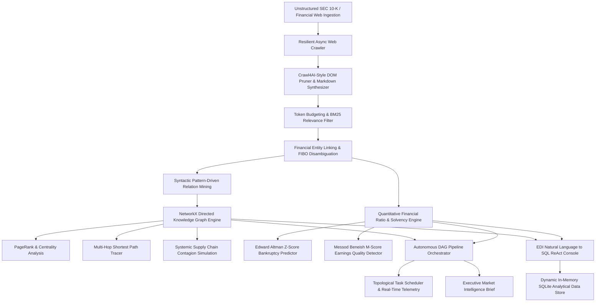

# Kuber Data Core (कुबेर) — Enterprise Financial Knowledge Graph & Market Cortex Pipeline

[](https://www.python.org/downloads/)
[](https://fastapi.tiangolo.com)
[](https://opensource.org/licenses/MIT)
[](https://github.com/ZephyrusZorro/kuber-datacore)
[](https://spec.edmcouncil.org/fibo/)

> **Kuber Data Core (कुबेर)** is an institutional-grade, distributed, autonomous web intelligence, financial knowledge graph, and market cortex pipeline. Inspired by Rao Muhammad Hamza's web scraping automation and local-first data analytics tooling (**EDI**), Kuber Data Core transforms messy financial web pages, SEC EDGAR 10-K/10-Q disclosures, and supply chain filings into structured, LLM-ready markdown, an in-memory FIBO-aligned knowledge graph, quantitative solvency metrics (Altman Z & Beneish M), and an interactive natural-language-to-SQL query engine.

---

## 1. System Architecture



---

## 2. Five Flagship Workstation Modules

### Module 1: Interactive Knowledge Graph & Contagion Engine
- **Canvas Force-Directed Physics:** Custom HTML5 canvas engine rendering nodes sized by market cap, sector-colored (Foundry Gold, Silicon Cyan, Cloud Emerald), with particle flow along supply routes.
- **Shortest Path Tracing:** Multi-hop relational resolution (e.g., ASML $\to$ TSMC $\to$ Nvidia $\to$ Azure).
- **Systemic Contagion Shock Simulation:** Models shock cascade down directed supply lines:
  $$\text{Shock}_{target} = \text{Shock}_{source} \times \text{Weight}_{edge} \times \gamma$$
  Quantifies total market capitalization at risk ($B) and systemic hazard tier.

### Module 2: Autonomous DAG Pipeline Orchestrator
- **Topological Task Execution:** Computes dependency ordering using `networkx.topological_sort` across multi-stage workflows (`FETCH_CRAWLER` $\to$ `PRUNE_DOM_MARKDOWN` $\to$ `EXTRACT_ENTITIES` $\to$ `LINK_CANONICAL_GRAPH` $\to$ `CALCULATE_RATIOS` $\to$ `SIMULATE_CONTAGION` $\to$ `SYNTHESIZE_EXECUTIVE_BRIEF`).
- **Telemetry Log Stream:** Millisecond duration tracking, step status tags (`PENDING`, `RUNNING`, `COMPLETED`), and automated executive memorandum generation.

### Module 3: Crawl4AI-Style Resilient Scraper & DOM Pruner
- **Boilerplate Pruning:** Strips scripts, styles, iframes, banners, and navigational elements using text-to-link density analysis ($\text{density} > 0.55$).
- **Structured Markdown Conversion:** Preserves heading hierarchies (`h1`–`h6`) and converts HTML tables into clean GitHub Flavored Markdown (GFM).
- **Token Compression:** Measures token savings percentage between raw HTML and pruned markdown.

### Module 4: EDI Natural Language to SQL ReAct Console
- **Inspired by Hamza's EDI:** Natural language prompts compiled into parameterized SQLite queries executed against analytical tables (`companies`, `financials`, `supply_chain`, `executives`).
- **Multi-Modal Inspection:** Renders natural language synthesis, synthesized SQL code, equivalent Graph Cypher queries, execution latency badges, and interactive data tables.

### Module 5: Quantitative Solvency Matrix (Altman Z & Beneish M)
- **Altman Z-Score:**
  $$Z = 1.2 X_1 + 1.4 X_2 + 3.3 X_3 + 0.6 X_4 + 0.999 X_5$$
  Stratifies into **Safe Zone** ($Z > 2.99$), **Grey Zone** ($1.81 \le Z \le 2.99$), and **Distress Zone** ($Z < 1.81$).
- **Beneish M-Score:** Evaluates financial statement manipulation risk using 8 forensic accounting indices (cutoff: $M > -1.78$).

---

## 3. Directory Structure

```text
kuber-datacore/
├── backend/
│   ├── __init__.py
│   ├── models.py                  # Pydantic v2 schemas
│   ├── web_crawler.py             # Resilient async HTTP crawler & mock filings
│   ├── dom_pruner.py              # Crawl4AI-style DOM pruner, BM25 & chunker
│   ├── entity_linker.py           # Financial NER & FIBO canonical linker
│   ├── knowledge_graph.py         # NetworkX directed graph & contagion engine
│   ├── financial_ratios.py        # Altman Z & Beneish M forensic ratios
│   ├── dag_orchestrator.py        # Topological DAG workflow engine
│   ├── edi_query_engine.py        # NL-to-SQL compiler & in-memory SQLite store
│   ├── sample_market_data.py      # Technology & semiconductor market dataset
│   ├── db.py                      # SQLite persistence layer
│   └── main.py                    # FastAPI service & static file router
├── frontend/
│   ├── index.html                 # Imperial Velvet Graphite FinTech Workstation
│   ├── css/
│   │   └── kuber.css              # Custom design system & animations
│   └── js/
│       ├── graph_visualizer.js    # Canvas force-directed graph simulator
│       └── app.js                 # Workstation controller & API glue
├── tests/
│   ├── test_crawler_pruner.py
│   ├── test_entity_linker.py
│   ├── test_knowledge_graph.py
│   ├── test_financial_ratios.py
│   ├── test_dag_orchestrator.py
│   ├── test_edi_engine.py
│   └── test_api.py
├── run_server.py                  # Port auto-discovery & browser launcher
├── test_e2e_kuber.py              # Live end-to-end workflow verification
├── start.bat                      # Windows one-click startup
├── run.ps1                        # PowerShell startup
└── requirements.txt
```

---

## 4. API Reference

| Method | Endpoint | Description |
| :--- | :--- | :--- |
| `GET` | `/api/health` | Service health status and engine readiness |
| `POST` | `/api/crawler/crawl` | Fetch target URL with anti-bot evasion headers |
| `POST` | `/api/crawler/prune` | Crawl4AI DOM boilerplate pruning & markdown synthesis |
| `POST` | `/api/entities/link` | FIBO entity disambiguation & relation extraction |
| `GET` | `/api/graph/view` | Full knowledge graph nodes, edges, and PageRank scores |
| `POST` | `/api/graph/shortest-path` | Multi-hop supply chain path calculation |
| `POST` | `/api/graph/simulate-contagion`| Systemic shock propagation simulation |
| `GET` | `/api/financials/ratios/{ticker}`| Altman Z, Beneish M, and valuation report |
| `GET` | `/api/financials/tickers` | Real-time market ticker tape stream |
| `GET` | `/api/dag/pipelines` | List available DAG pipeline specifications |
| `POST` | `/api/dag/execute/{id}` | Run autonomous DAG pipeline and generate executive brief |
| `POST` | `/api/edi/query` | Natural language to SQL & Graph query execution |

---

## 5. Quickstart & Verification

### Launching the Workstation

Double-click `start.bat` on Windows or execute:
```bash
python run_server.py
```
The intelligent launcher automatically:
1. Reuses any running daemon on port `8002` without port collision.
2. Finds the next free port if occupied.
3. Automatically launches your default browser at `http://127.0.0.1:8002/`.

### Running Tests

Execute the unit test suite:
```bash
python -m pytest tests/
```

Execute the live end-to-end integration test:
```bash
python test_e2e_kuber.py
```
